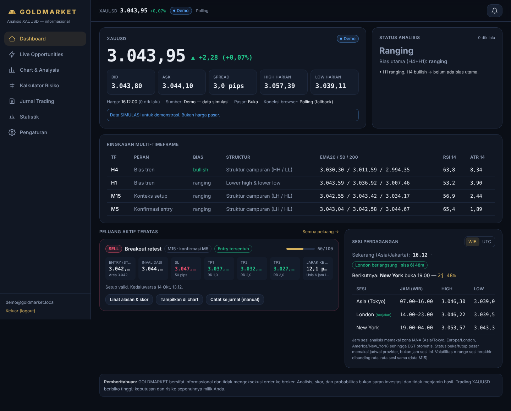

# GOLDMARKET — Platform Analisis XAUUSD

Website analisis XAUUSD yang berfungsi nyata: data pasar → validasi data → analisis multi-timeframe otomatis → setup (trend pullback & breakout retest) → notifikasi → jurnal manual → statistik. Bahasa Indonesia, dark mode, responsif.

> **Pemberitahuan:** GOLDMARKET bersifat informasional, **tidak mengeksekusi order ke broker**, dan tidak menjamin hasil. Tidak ada klaim akurasi atau keuntungan; probabilitas hanya ditampilkan bila sudah divalidasi historis (lihat `docs/STRATEGY.md` §9).

**Live:** https://osca123-cmd.github.io/goldmarket/



## Fitur

| Menu | Isi |
|---|---|
| Dashboard | Harga terakhir, bid/ask, spread, perubahan harian, high/low, waktu update, sumber, status feed (Live / Delayed / Reconnecting / Disconnected / Market Closed / Demo), status analisis + alasan, ringkasan H4/H1/M15/M5, peluang teratas, sesi Asia/London/New York (WIB/UTC, countdown, range, volatilitas) |
| Live Opportunities | Filter arah/TF/strategi/skor/sesi/status/kelayakan; jarak ke entry (pips), usia, alasan & gate, skor per komponen, probabilitas historis (bila memadai) |
| Chart & Analysis | Candlestick M1–D1 (lightweight-charts), zoom/pan/crosshair, EMA 20/50/200, RSI 14, ATR 14, S/R, area entry, SL/TP1-3, invalidasi, toggle overlay; tab widget TradingView terpisah (tampilan saja) |
| News AI | Berita emas dari RSS gratis (Google News, Investing.com, Federal Reserve, CNBC, MarketWatch) dengan label otomatis Bullish/Bearish/Netral untuk XAUUSD + alasan berbasis aturan; kalender ekonomi USD (ForexFactory) dengan countdown; push "⚠️ NEWS BESAR N menit lagi". Gratis, tanpa API key — lihat `docs/STRATEGY.md` §12 |
| Kalkulator Risiko | Risiko nominal, jarak SL (pips), lot (dibulatkan ke bawah per lot step), nilai pip per lot dari spesifikasi broker + kurs, profit tiap TP, RR sebelum/sesudah biaya |
| Jurnal Trading | Catat manual / dari setup; entry aktual, lot, SL, TP, waktu, biaya; milestone TP terpisah dari status akhir; partial close; tutup TP1/TP2/TP3/SL/BE/manual/cancelled dengan konfirmasi; pindah SL ke BE; catatan; screenshot (≤ 5 MB, PNG/JPEG/WEBP); histori perubahan otomatis (trigger DB) |
| Statistik | Win rate, net P/L, profit factor, avg win/loss, R-multiple, drawdown, per strategi/sesi/TF, kalender, kurva ekuitas, ekspor CSV, penjelasan metode |
| Pengaturan | Pip/tick/desimal/contract size, lot step/min/max, komisi, mata uang & kurs, risiko, ambang notifikasi (default 20 pips), cooldown, skor minimum per TF, jenis notifikasi, browser push, zona waktu |

## Arsitektur

```
Browser (Next.js static export, React, Tailwind)
   │  anon/publishable key + RLS          ▲ Supabase Realtime (WebSocket) + fallback polling
   ▼                                       │
Supabase ── Postgres (RLS, trigger, RPC) ── Auth ── Storage (screenshot privat)
   ▲
   │ pg_cron tiap menit → pg_net → Edge Function `engine` (Deno)
   │      provider data (server-side, secret di env/Vault)
   │      → validasi data → analisis → setup/dedupe → status → notifikasi
   └ pg_cron harian → `engine` mode backtest → probability_stats
```

Modul inti (TypeScript murni, tanpa dependensi runtime) di `src/core/`:

| Modul | Tanggung jawab |
|---|---|
| `instrument.ts` | pip/tick/desimal/contract size, level SL/TP |
| `indicators.ts` | EMA, RSI (Wilder), ATR (Wilder) |
| `structure.ts` | swing, HH/HL/LH/LL, level S/R, pola konfirmasi |
| `dataQuality.ts` | dedupe candle, candle tertutup, celah, status feed, backoff |
| `analysis.ts` | analisis per TF & bias multi-TF |
| `strategies.ts` / `scoring.ts` | deteksi setup, gate wajib, skor |
| `setups.ts` | identitas, dedupe, cooldown, lifecycle status |
| `engine.ts` | satu siklus engine tanpa I/O |
| `providers.ts` | Twelve Data, Spot hybrid (gold-api XAU spot + candle PAXG tergeser basis), Binance PAXG (proxy), Demo |
| `sessions.ts` / `time.ts` | sesi IANA + DST, jadwal pasar |
| `risk.ts` | ukuran lot & biaya |
| `journal.ts` / `stats.ts` | P/L terealisasi, R, statistik, CSV |
| `backtest.ts` | walk-forward, Wilson CI, split dev/test |

Edge Function (`supabase/functions/engine/index.ts`) memakai salinan modul yang sama (`npm run sync:core`).

## Instalasi lokal

```bash
git clone https://github.com/Osca123-cmd/goldmarket && cd goldmarket
npm install
cp .env.example .env.local      # isi NEXT_PUBLIC_SUPABASE_URL & NEXT_PUBLIC_SUPABASE_ANON_KEY
npm run dev                     # http://localhost:3000
npm test                        # unit test (vitest)
npm run build                   # static export ke out/
npx tsx scripts/ui-smoke.ts     # uji UI desktop+mobile (butuh Chromium Playwright)
```

Database: jalankan migrasi di `supabase/migrations/` (Supabase CLI `supabase db push` atau SQL editor), lalu deploy function: `supabase functions deploy engine --no-verify-jwt`. Detail lengkap: [`docs/DEPLOYMENT.md`](docs/DEPLOYMENT.md).

## Konfigurasi data pasar

Pilih provider dengan secret Edge Function `MARKET_PROVIDER` (atau `engine_state.config.provider`):

| Provider | Kredensial | Catatan |
|---|---|---|
| `twelvedata` (disarankan untuk XAUUSD) | `TWELVEDATA_API_KEY` | REST polling. Paket gratis 8 kredit/menit & 800/hari → set `QUOTE_INTERVAL_SEC=300` (status akan *Delayed*). WebSocket Twelve Data butuh paket berbayar. Tidak memberi bid/ask → spread "Tidak tersedia", RR memakai spread asumsi. |
| `spot_hybrid` (default saat ini) | tidak ada | Harga = **XAU spot** dari gold-api.com. Candle chart & analisis = PAXG/USDT (Binance) yang digeser *basis* (spot − PAXG, diperbarui hanya saat pasar buka & spot segar, disimpan di `engine_state.basis`). Bila gold-api gagal: harga = PAXG + basis terakhir dan diberi catatan. Bid/ask tidak tersedia. |
| `binance_paxg` | tidak ada | **Proxy**: PAXG/USDT (token emas), bukan XAUUSD spot — bisa selisih beberapa dolar dari spot. Selisih harga & spread ditampilkan sebagai peringatan; sinyal tetap mengikuti jam pasar emas. |
| `demo` | tidak ada | Data simulasi deterministik, selalu berstatus **Demo**. |

Pastikan lisensi provider mengizinkan penggunaan Anda (data pasar hanya dapat dibaca pengguna yang login).

## Dokumen

- [`docs/STRATEGY.md`](docs/STRATEGY.md) — aturan strategi, gate, skor, probabilitas, News AI
- [`docs/DEPLOYMENT.md`](docs/DEPLOYMENT.md) — deployment & konfigurasi
- [`docs/TESTING.md`](docs/TESTING.md) — hasil pengujian
- [`docs/CREDENTIALS.md`](docs/CREDENTIALS.md) — integrasi yang masih butuh kredensial / langkah manual
